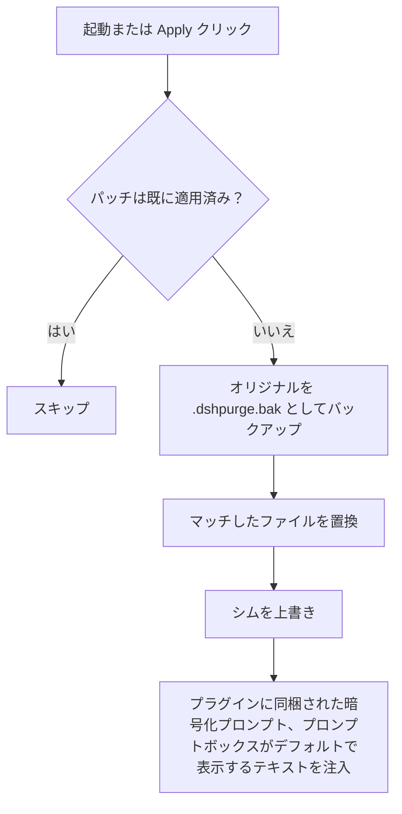
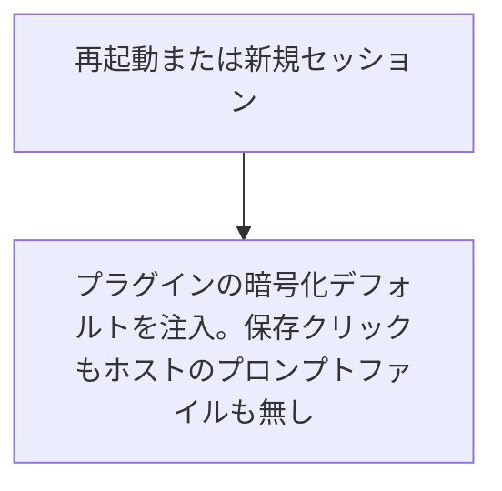
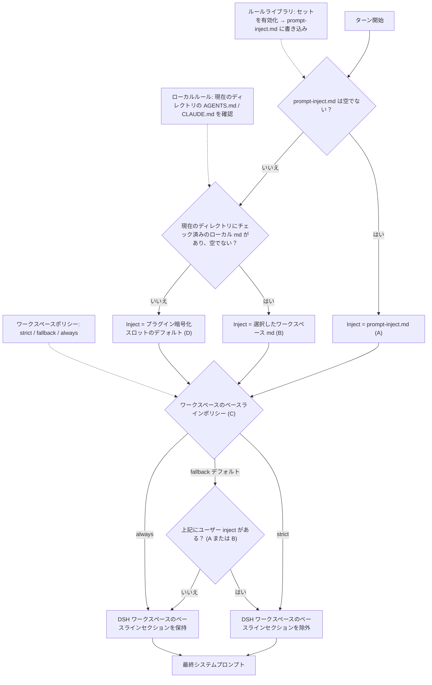

<p align="center">
  
</p>

<h1 align="center">⚔️ DeepSeek Harness サイバーセキュリティ レッドチームツール (dsh-purge)</h1>

<p align="center"><strong>バージョン 1.1.88</strong></p>

<p align="center">
  <em>DeepSeek Harness のジェイルブレイク: すべてのモデルに対応し、モデルごとにプロンプトを切り替え。デフォルトプロンプトは 小码酱 用。ぜひ Star ⭐ を。これをベースに開発する場合は「要帰属表示」をご覧ください。</em>
</p>

<p align="center">
  <a href="https://github.com/YuJunZhiXue/dsh-purge/stargazers"></a>
  <a href="https://github.com/YuJunZhiXue/dsh-purge/blob/master/LICENSE"></a>
  <a href="https://awesome-dsh-plugin.com"></a>
  <a href="https://deepseek.stream/plugins/dsh-purge"></a>
  <a href="https://www.deepseek.com/harness/"></a>
  <br>
  
  
</p>

<p align="center">
  <a href="https://dsh-plugin.org/plugins/yujunzhixue/dsh-purge"></a>
</p>

<p align="center">
  <a href="README.md">English</a> | <a href="README.zh-CN.md">中文</a> | <a href="README.ja.md">日本語</a>
</p>

## 作者より

このオープンソースの成果物を、公然と売りさばく人たちがいました。その後、作者は呼び出されて話をすることになりました。あとは言わずもがな。行間を読んでください。

今後、**公開インターネットは閉じます**。オープンソース版では **ローカルのラボ IP のみ** を許可します（ループバックと RFC1918）。ドメインは先に名前解決され（hosts も含む）、すべての応答がプライベートまたはループバックでなければなりません。`.lab` を公開 IP に向ける hosts トリック、名前解決の失敗、公開 IP が混じった応答はブロックされます。**ゲームチートは禁止です**（エイムボット、ウォールハック、メモリ改ざん、アンチチート回避）。プロンプトとセッションゲートの両方で阻止します。このビルドにはスキルライブラリやナレッジベースは同梱されません。

**オリジナルビルドの転売は禁止です。** 課金、スキン変更、グループでの売り込みは許可されません。フォークは自由ですが、**帰属表示が必須** で、出所を明記してください: [YuJunZhiXue/dsh-purge](https://github.com/YuJunZhiXue/dsh-purge)。出所を隠したり、自分のものとして偽ったりすれば、あなたは向こう側です。

作者の個人チャンネル: [t.me/LLM_PoJia](https://t.me/LLM_PoJia)。メモや更新情報はそこに出ます。

## 目次

- [作者より](#作者より)
- [これは何か](#これは何か)
- [要帰属表示](#要帰属表示)
- [ライセンス](#ライセンス)
- [対応ホスト](#対応ホスト)
- [インストール](#インストール)
- [インストールガイド](docs/INSTALL.ja.md)
- [プレビュー](#プレビュー)
- [使い方](#使い方)
- [仕組み](#仕組み)
- [復元](#復元)
- [リリース](#リリース)

---

## これは何か

**dsh-purge** は、お使いのマシンにインストール済みの公式 [DeepSeek Harness](https://www.deepseek.com/harness/) 向けサイバーセキュリティ・レッドチームプラグインです。この fork のプレビュー版は **1.1.88** です。以下の対応表は upstream の互換性基準を引き継いでおり、**DSH 0.2.1-rc.2**（0.2.0 も動作すると記載）を基準とします。**DSH 0.2.1-rc.3 以降の RC はサポート対象として記載されていません。** この fork の UI 変更は、すべてのホスト版で実機検証されていません。公式 **Web**（`dsh web`）と公式 **デスクトップ EXE** は別々にインストール・適用します。

Harness は単にプロンプトを転送するだけではありません。プロンプトの書き換え、承認ゲート、サンドボックスポリシー、セッション移行を実行時に行います。「モデルは答えるか」だけを問うと、ホスト層のブロックをモデルの拒否と取り違えてしまいます。このプラグインは、あなた自身のインストール環境でこの 2 つの層を分離し、制御された評価や、どのデフォルトポリシーが過度に厳しいかを確認するために使います。

| 得られるもの | 内容 |
|---|---|
| **dsh-purge ドック** | セッションタイトルの横のボタンで右ドックを開く。2 ページ: Clean と Drill |
| **Clean** | グループ化されたパッチ状況、Apply / Restore / Uninstall、プロンプトエディタ、複数のルールセット |
| **Drill** | 安定版に内蔵。認可後: アセットとローカル環境。このビルドはスキルやナレッジベースを同梱しません。ローカルラボ専用 |
| **ホストポリシー** | デフォルトのコピー、権限ポリシー、ツール制限。公式の機能はそのまま。2 つ目の架空アイデンティティは作らない |
| **起動時** | チェックして再適用。npm が `node_modules` を上書きした後も、ファイルを手編集しなくてよい |

ドライブレターのハードコードはありません。`$DSH_HOME`、dsh ランチャー横の `.dsh`、次に `~/.dsh` を参照します。Harness のソースツリーにはパッチしません。変更を書き込むのは **dsh-purge** の **Clean** ページの **Apply** です。アイデンティティはプラグインに同梱された暗号化プロンプト、つまりプロンプトボックスがデフォルトで表示するテキストから来ます。ホストのプロンプトファイルは読みません。

触れるのはユーザーのマシン上の公式 `@deepseek-ai` パッケージとローカル設定だけです。公開スキャナーでもなく、第三者サイトへの攻撃キットでもありません。リポジトリにマルウェア、未認可のエクスプロイトスクリプト、公開インターネットを狙うペイロードは同梱されていません。

---

## オリジナルの転売は禁止。フォークは帰属表示が必須。

## 要帰属表示

**オリジナルビルドの転売は禁止です。** 有料での転売、スキン変更したストア掲載、グループでの売り込みは禁止です。

**フォークは帰属表示が必須** で、出所のリポジトリを明記してください: [YuJunZhiXue/dsh-purge](https://github.com/YuJunZhiXue/dsh-purge)。名前、アイデア、コード、プロンプトを借用する場合も同様です。

出所を隠す、自分のものとして偽る、オリジナルを転売する行為は追及します。

## ライセンス

本リポジトリは [Apache License 2.0](./LICENSE) です。フォークおよび再配布では著作権表示と [NOTICE](./NOTICE) を保持し、[YuJunZhiXue/dsh-purge](https://github.com/YuJunZhiXue/dsh-purge) を明記してください。オリジナルの転売は禁止です。

---

<a id="strict-legal--compliance-disclaimer"></a>

<div>

### ⚠️ <font color="red">厳格な法的・コンプライアンス免責事項</font>

<font color="red">

**免責事項:** 本プロジェクトは非営利のオープンソースプロジェクトです。適用される法律および利用するプラットフォームの規則に従い、学習と研究のみを目的としています。違法または非準拠の目的に使用しないでください。生じた結果は利用者が負います。

**ゼロトレランス声明:** 本プロジェクトはいかなる違法行為にも反対し、禁止します。作者は、未認可のネットワーク攻撃、エクスプロイトの使用、データの窃取、コンピュータ情報システムへの不正侵入、違法または禁止されたコンテンツの生成を支援、奨励、幇助しません。**本プロジェクトを犯罪に使用した者は、法律上すべての責任を単独で負います。作者は一切の責任を負いません。**

1. **本リポジトリに違法な素材は含まれません。** 公開されているコード、ドキュメント、パッチ、デフォルトプロンプトは、マルウェア、バックドア、未認可のペンテストキット、ランサムウェア、クレデンシャルスタッフィングスクリプト、公開インターネットや第三者システムを狙う攻撃ペイロードでは **ありません**。本プロジェクトは違法コンテンツを提供せず、犯罪を扇動・組織・幇助しません。
2. **ローカルの公式 Harness のみ。** セキュリティ評価用パッチとプロンプトインジェクションは、**ユーザーのマシンにすでにインストールされた公式 DeepSeek Harness**（`@deepseek-ai` パッケージ、ローカルプロファイル / `$DSH_HOME`）に対してのみ動作します。対象はユーザー自身の公式ローカルソフトウェアであり、**他人のウェブサイト、サーバー、アカウント、情報システムではありません**。
3. **評価用パッチは公開インターネットを攻撃しません。** Apply、インジェクト、リバート、アンインストールはすべてローカルファイルとローカルプロセス内に留まります。いかなる公開ホストや未認可システムに対しても、**スキャン、探査、侵入、攻撃トラフィックの送信を行いません**。本プロジェクトを公開インターネットへの踏み台として使わないでください。「更新確認」が有効な場合、プラグインはバージョン比較のために本プラグイン自身の GitHub リポジトリにのみアクセスすることがあります。これは第三者システムへの攻撃では **なく**、何かへの侵入を認可するものでも **ありません**。
4. **合法かつ制御された範囲。** 本プロジェクトは、ユーザーが **管理する権限を有する公式 Harness** 上でのレッドチーム研究と堅牢性評価の補助ツールです。**所有者の合法的な書面による認可のないターゲット、公開オンラインシステム、本番ワークロードに対して実行しないでください。** テストは **認可されたローカルの公式 Harness、オフラインのローカル合成フィクスチャ、認可されたサイバーセキュリティレンジ、準拠したラボ環境** に限ります。
5. **オープンソース版はローカルラボ専用です。** 攻撃タスクはループバックと RFC1918 アドレスのみ許可します。ドメインは名前解決され、IP で判定されます。サフィックスは許可リストではありません。公開 IP、公開に解決される名前、名前解決の失敗、ラボ名を公開インターネットに向ける hosts エントリは例外になりません。キー、パスワード、ネットワーク範囲、ワイルドカード、会話内での主張は例外を追加しません。ゲームチートは禁止です。このビルドにはスキルライブラリやナレッジベースは同梱されません。
6. **禁止される用途。** 利用者は、本プロジェクトを直接・間接を問わず、以下に違反する目的で使用してはなりません（いずれも遵守必須。回避の口実は認められません）:
   - <font color="red"><strong>中華人民共和国刑法</strong></font>
   - <font color="red"><strong>中華人民共和国サイバーセキュリティ法</strong></font>
   - <font color="red"><strong>中華人民共和国データセキュリティ法</strong></font>
   - <font color="red"><strong>中華人民共和国個人情報保護法</strong></font>
   - その他適用される法律、規制、監督規則；
   - さらに以下も禁止:
   - 公的・私的なコンピュータ情報システムへの未認可の侵入または攻撃；恐喝、破壊、クレデンシャルスタッフィング、悪意あるペイロードの拡散；
   - 国家安全保障への脅威、テロ、暴力、ポルノ、賭博、詐欺、プライバシーや知的財産権の侵害を含む、法律が禁じるあらゆるコンテンツの誘発・生成・拡散；
   - モデル提供者の利用規約および利用許諾ポリシーへの違反。
7. **利用者がすべての責任を負います。** 本プロジェクトは Apache-2.0 の下で現状のまま提供されます。作者は完全性、安全性、適合性について一切保証しません。**利用者は、ダウンロード、デプロイ、実行、改変、配布、およびそれに伴うすべての入力と出力について、民事・行政・刑事上のすべての責任を独立して負います。** 作者および貢献者は、悪用について直接・間接・連帯のいかなる責任も負いません。
8. **違反時にライセンスは終了します。** 本プロジェクトを違法な攻撃、悪意ある活動、その他の違反に使用した者は、違反の瞬間からオープンソースライセンスが **自動的かつ取り消し不能に終了** します。使用を直ちに停止し、すべての複製と派生物を永久に破棄し、法的制裁を受け入れなければなりません。
9. **無関係。** 本プロジェクトは独立したオープンソースのセキュリティ評価研究プロジェクトです。DeepSeek またはその関連会社との間に、雇用、商業、認可、推奨のいかなる関係もありません。ここでの「公式」は、評価対象がユーザーのマシン上の公式 DeepSeek Harness パッケージであることだけを意味します。DeepSeek が本プラグインを開発・承認・保証したことを **意味しません**。
10. **帰属表示は必須です。** 本プロジェクトの名前、アイデア、コード、プロンプトを借用する場合は、作者をクレジットし本リポジトリを明記しなければなりません。帰属表示の不履行は追及します。[要帰属表示](#要帰属表示) を参照してください。

</font>

</div>

---

## 対応ホスト

**互換性について:** 以下の表は upstream の 1.1.81 ドキュメントから引き継いだものです。この fork は 1.1.88 ですが、記載された各 DSH バージョンで独立した実行時再検証は完了していません。記載のない RC をサポート対象と見なさないでください。

- **dsh 0.2.1-rc.2**（公式デスクトップ / 公式 `dsh web`）: **1.1.81** を使用。`{{cwd}}` / `[cwd]` クラッシュ、patch #40 のマッチ、削除された `toolFilter`、ホスト `dsh-tools` の解決、hostFs の fd、デスクトップヘルパーの自己終了、`file:` アーカイブ更新、Ctrl+Enter ステアを修正。
- **dsh 0.2.0-rc.2**: **1.1.40** 以降を使用。このラインもインストールできます。
- **dsh 0.1.7**（rc.1 / rc.2 を含む）: **1.1.39** 以前を使用 — [Releases](https://github.com/qingjian0/dsh-purge/releases) で該当タグを選択。
- **dsh 0.2.1-rc.3 / rc.4 以降は非対応です。** マッチしないパッチは pending または skipped のままで、盲目的な書き換えはしません。**0.2.1-rc.2** に留まってください。

マッチしないパッチは pending または skipped のままで、盲目的な書き換えはしません。

---

## インストール

**現在の fork 開発プレビュー:** 以下のコマンドは保守中の `adapt/android-mobile-upstream-1.1.88` ブランチからインストールします。ブランチのアーカイブはコミットにより変わるため、固定リリースではありません。

### 推奨: DSH CLI

実際に使用するホストを 1 つ選択してください。Web とデスクトップは別々の profile です。

```sh
# 公式 Web
dsh plugin --profile web add https://codeload.github.com/qingjian0/dsh-purge/tar.gz/refs/heads/adapt/android-mobile-upstream-1.1.88

# 公式デスクトップ
dsh plugin --profile desktop add https://codeload.github.com/qingjian0/dsh-purge/tar.gz/refs/heads/adapt/android-mobile-upstream-1.1.88
```

### 代替: pnpm

DSH CLI が使えない場合のみ、選択した profile 内で実行します。

```sh
cd "$DSH_HOME/profiles/web"   # desktop: profiles/desktop
pnpm add --allow-build=dsh-purge https://codeload.github.com/qingjian0/dsh-purge/tar.gz/refs/heads/adapt/android-mobile-upstream-1.1.88
```

Windows PowerShell:

```powershell
cd "$env:USERPROFILE\.dsh\profiles\web"   # desktop: profiles\desktop
pnpm add --allow-build=dsh-purge "https://codeload.github.com/qingjian0/dsh-purge/tar.gz/refs/heads/adapt/android-mobile-upstream-1.1.88"
```

インストールフックは選択した profile にプラグインを登録し、Cordis の body insert を確認します。pnpm がビルドスクリプトを既定でブロックする場合、`--allow-build=dsh-purge` はこのパッケージだけを許可します。

### インストール後

1. インストールした同じホストを完全終了して再起動します。デスクトップではトレイプロセスも終了してください。
2. チャットを開き、セッションタイトルの横にある **dsh-purge** を確認します。
3. **Clean** を開いて **Apply** をクリックします。
4. チャットで `/purge status` を実行し、`DSH_HOME` が意図した profile であることを確認します。

インストールだけではパッチは適用されません。Web とデスクトップは個別にインストール・適用する必要があります。

### トラブルシューティング

ボタンが表示されない場合、選択した profile に以下があるか確認します。

- `node_modules/dsh-purge/package.json`
- `dsh-purge` を含む `dsh.profile.bundles`
- `dsh-purge` の body insert を含む `cordis.patch.yml`

登録が不足している場合、profile ディレクトリで次を実行してホストを再起動します。

```sh
node node_modules/dsh-purge/scripts/ensure-profile-bundle.mjs
```

pnpm が install hook をブロックした場合は、`--allow-build=dsh-purge` を付けて再インストールします。完全な手順は[インストールガイド](docs/INSTALL.ja.md)を参照してください。

## プレビュー

**dsh-purge** はセッションタイトルの横にあります。右ドックを開き、**Clean** と **Drill** の 2 ページがあります。**Light / Ink** を切り替えられます。パッチはグループ化され、カウントには実際に適用された項目のみが含まれます。ルールセットはエディタの上の一覧にあり、各行に Enable と Delete があります。

Drill を初めて開くときは、通知を読み、カウントダウンを待ち、末尾までスクロールして 3 つのチェックボックスにチェックします。Clean にこのステップは不要です。Drill は、あなたが管理するホスト、オフラインターゲット、またはすでに書面による認可のある演習にのみ使えます。

**Clean**


**Drill 認可**


**Drill**


**パッチ**


**ローカルラボ**

オープンソース版は localhost / プライベートネットのみ許可します。Clean ページにそう書かれています。公開ホストは登録できません。

| エリア | 表示内容 |
|---|---|
| dsh-purge | セッションタイトル横のボタン。ドックを開閉する |
| Clean | パッチ、プロンプト、ルールセット |
| Drill | 認可後のアセットと環境。このビルドはスキルやナレッジベースを同梱しません。認可までタブは Unauthorized と表示 |
| Patches | グループ化された状況、Apply、Restore、Uninstall |
| Prompt | `prompt-inject.md` をセッションのオーバーライドとして編集 |
| Local lab | ループバック / RFC1918 のみ。名前は解決され、すべてのアドレスがプライベートでなければならない |
| Rule sets | 複数の `AGENTS.md` / `CLAUDE.md`。Enable は `$DSH_HOME` 以下に書き込み、Delete は行を削除 |

---

## レイアウト

`bin/` は CLI、`lib/` はパッチと drill コンソール、`presets/redteam/` はレッドチームプリセット、`client.js` はドックです。このビルドは `skills/` やナレッジベースを同梱しません。

ランタイムファイルは `$DSH_HOME` 以下にあります: `prompt-inject.md`、`rules/`、`redteam/`。`DSH_HOME` が未設定の場合、ランチャー横の `.dsh` が `~/.dsh` より優先されます。Web とデスクトップアプリはそれぞれ独自のホームを使います。

---

## 使い方

```sh
dsh-purge --status
dsh-purge --apply
dsh-purge --revert
dsh-purge --uninstall
dsh-purge --edit

/purge status | apply | revert | uninstall | edit | help
/rules list | use <id> | create <id> | delete <id> | reset | help
/rewind

# 別のプラグインがすでに /rewind（または /purge, /rules, /skills）を
# 所有している場合、その名前はスキップされるか /purge-rewind として
# 再マウントされます。ほかのコマンド、ツール、/dsh-purge/* ルートは動作し続けます。

purge_status   purge_apply   purge_revert
```

Apply が成功すると、パッチ済みパッケージを読み込むためホストが再起動します。手動で **Restart** をクリックすることもできます。パッチタイトルの下に安定版とテスト版があります。テスト版は `beta` ブランチに追従します。**Switch to stable** は `master` をインストールしてピンを解除します。古い安定版を選ぶとそれがピン留めされます。最新に戻すには **Update** をクリック。古いテストタグは一覧されません。

コンポーザの **Undo once** と **Undo last round** は現在の会話内に留まり、ブランチを開きません。送信した行が入力に戻り、そのカットですでに送信されたメッセージと完了したタスクは現在の会話から外れます。編集して **再送信** します。**1.1.61** から、rewind の範囲は最初のユーザーメッセージではなく **現在のターン** に従います。`/rewind` も同じ動作です。

**同じタスクが standard では動くのに minimal や PTC で失敗する** 場合、プリセットの `run_code`、サンドボックス、またはプラン傍受テキストがまだクリアされていないことが多く、あるいは組み込み minimal に `agent-instructions` が欠けています。**1.1.61 以降** を使い、**ホストを完全に終了 → Clean で Apply → 再起動 → 新しいチャットを開始** してください。プリセットを切り替えるだけでは、実行中のプロセスのパッチは再読み込みされません。

### 応答速度

DSH はツールバッチ内の Bash 呼び出しを 1 つずつ実行します。古い dsh-purge リリースはデフォルトのフォアグラウンド待機を 60 秒から 10 分に引き上げていたため、1 つの遅いコマンドが後続の呼び出しをその間ブロックしていました。patch #21 は、マークされたプラグインの値を公式の 60 秒デフォルトに戻します。マークされていないタイムアウトやその他のカスタム値は保持されます。マークのない 10 分の値はユーザー設定と確実に区別できません。

`dsh web`（macOS/Linux）で待機を短くするには、`$DSH_HOME/profiles/web/cordis.patch.yml`（通常 `~/.dsh/profiles/web/cordis.patch.yml`）に次のエントリを追加します。重複を追加せず、同じ id の既存エントリを編集してください。このプロファイル層は同梱設定の後に適用されるので、今後のプラグイン Apply でもオーバーライドが維持されます。

```yaml
- id: bash-sandbox
  config:
    timeoutMs: 10000
```

標準のジョブサービスと `promoteOnTimeout: true` では、未完了のコマンドは 10 秒後にバックグラウンドジョブ id を返し、実行を続けます。`job_output` で読み、`job_kill` で停止します。これはフォアグラウンドの待機を変えるもので、コマンド自体の速度は変わりません。そのサービスが無い、またはプロモーションが無効の場合、タイムアウトでコマンドは終了します。呼び出しごとの `timeoutMs` はこのデフォルトを上書きし、`run_in_background: true` は即座にジョブ id を返します。

日常的なタスクでは、新しいセッションに対して Low 推論を選ぶこともできます:

```yaml
- id: agent-default-model
  config:
    provider: deepseek-official
    model: deepseek-flash
    reasoningEffort: low
```

プロファイルを読み込むには `dsh web` を再起動します。モデルと推論のデフォルトは新規作成されるセッションに適用されます。既存のセッションではコンポーザで Low を選択します。プラグインはこれらのモデル設定を自動で変更しません。より深い推論が必要なタスクでは High を保ち、すべてのアプリケーションディレクトリを再帰的にスキャンするのではなくファイル検索を絞ってください。

### ローカルラボ

攻撃タスクはデフォルトで拒否されます。オープンソース版はループバックと RFC1918 IP のみ許可します。名前は先に解決されます。`.lab` / `.htb` サフィックスだけでは不十分です。ラボ名を公開 IP に向ける hosts エントリはブロックされます。チャットで「これは自分のサーバーだ」と言っても許可されません。

---

## ローカルチェック

```sh
node --check lib/index.js
node --check lib/core.js
node --check lib/surface.js
node --check lib/web.js
node --check lib/desktop.js
node --check lib/host.js
node --check lib/rewind.js
node --check lib/skills.js
node --check client.js
```

---

## 仕組み

Apply（起動時または Apply クリック時）:



各セッションでのオーバーライド:



毎ターンのプロンプトインジェクションとルールセット判定。左側の 3 つの入力は dsh-purge パネルで制御するもので、点線の辺はそれぞれがどの判定を駆動するかを示します:



---

## 復元

- 各ターゲットは最初の apply 前に `<file>.dshpurge.bak` にコピーされます。
- **Restore** または `/purge revert` はバックアップを戻して削除します。バックアップが無い場合は、このプラグインが書いたシム行を取り除きます。
- `prompt-inject.md` はユーザーファイルなので保持されます。
- **Uninstall** はパッチが適用されていればまず復元し、その後 inject ファイル、ルールライブラリ、プラグイン本体を削除します。
- Apply は冪等です。

---

## パス検出

まずホストのサーフェスを検出します: `web` / `desktop`（`gui` / `tui` は予約済みで、なお web にフォールバックします）。

**Web:**

1. `DSH_HOME` / `DSH_BASE`
2. dsh ランチャー横の `.dsh`（ポータブルインストール、任意のドライブ）
3. `npm prefix -g` / `npm root -g`
4. ネストした `@deepseek-ai/dsh/node_modules/@deepseek-ai`
5. `~/.dsh`

**公式デスクトップ EXE:** 実行中の公式 Harness インストール（`resources/app` または展開されたパッケージ）。ドライブレターはハードコードされません。成功した Apply は 1 回再起動します。

Community Desktop はメンテナンスされていません。

公式の npm グローバルはパッチされません。封印された `host-commands` / `runtime-commands` はスクラブされ、注入されることはありません。

何も見つからない場合は `DSH_BASE` / `DSH_DESKTOP_INSTALL` を設定してください。ファイルは変更されません。

---

## リリース

作者の個人チャンネル: [t.me/LLM_PoJia](https://t.me/LLM_PoJia)。メモや更新情報はそこに出ます。GitHub [Releases](https://github.com/qingjian0/dsh-purge/releases) には古いパッケージもあります。オリジナルの転売は禁止、フォークは帰属表示が必須です。

## 備考

- 対象範囲は、ローカルの `@deepseek-ai/*` パッケージ内のレンダリング済みコピー、デフォルト、ランタイムロジック、および harness ホーム以下のオーバーライドファイルとルールセットです。
- アップグレード後、マッチしないオリジナルは skipped と表示されます。Apply はなお完了し、それらのファイルは変更されません。
- `@deepseek-ai` 外のサードパーティプラグインの *ソースリポジトリ* には手を付けません（CMD サイレンスは、インストール済みの doctor / market / liangshen / mnemon を実行時に **ベストエフォートで** パッチすることがあります）。
- GitHub tarball からインストールしてください（名前は npm にありません。プラグインマーケットはスキップ）。`dsh` あり: `dsh plugin --profile web add https://codeload.github.com/YuJunZhiXue/dsh-purge/tar.gz/refs/heads/master`。pnpm のみ: `$DSH_HOME/profiles/web` 内でその URL を `pnpm add`。EXE には `desktop` を使用。このリポジトリからは `add .`。

---

[LINUX DO](https://linux.do) コミュニティに感謝します
